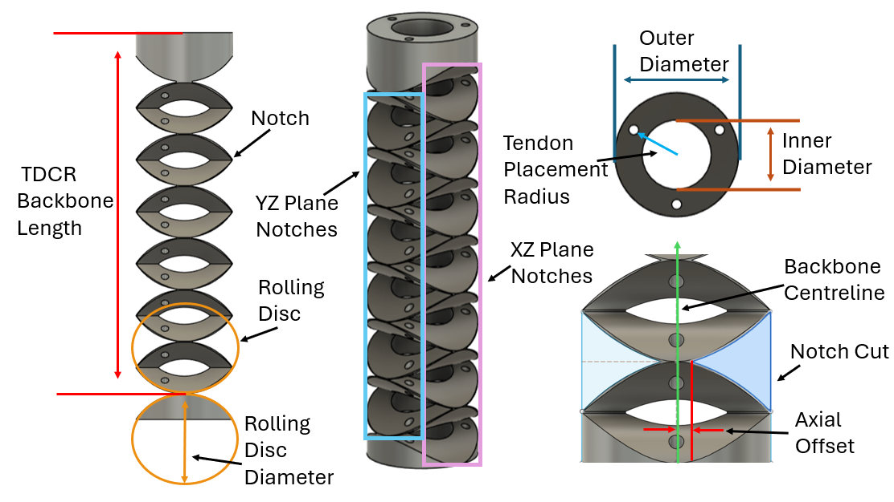
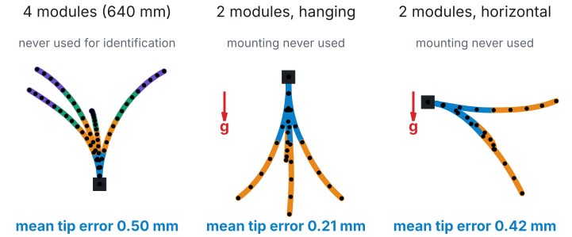
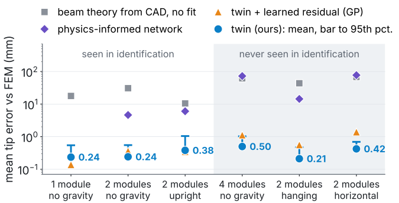

# ME 299: From Geometry to a Real-Time Digital Twin of Rolling-Disc Notched Tendon-Driven Continuum Robots

**Om Mohan Pawar** (25110218) · Supervisor: **Prof. Madhu Vadali** · IITGN Robotics Laboratory, Mechanical
Engineering, IIT Gandhinagar · 2026

**Report:** [PDF, 5 pages](docs/report.pdf) (LaTeX source in [`report/`](report/)) · **Website:**
[om-mpawar.github.io/ME299-25110218](https://om-mpawar.github.io/ME299-25110218/) · **Poster:** [A0 PDF](poster/poster.pdf)

<p align="center"></p>

This repository is the course record of my ME 299 project. It holds the two research outputs of the semester, the
reading behind them, and a plan for continuing the work.

| Folder | What it is | Status | My role |
|---|---|---|---|
| [`ICRA/`](ICRA/) | **SWEEP**: an automated CAD → tetrahedral mesh → SOFA FEM pipeline, and a parametric study of how notch geometry sets bending | IEEE ICRA 2027, under review. D. Yadav, **O. M. Pawar**, Krishnapriya R, S. Gandhi, M. Vadali | Second author |
| [`RA-L/`](RA-L/) | **tdcr-twin**: a sensor-free, real-time digital twin of a modular notched TDCR (Python package, FEM data, results, paper draft) | In preparation for IEEE RA-L | Lead author |
| [`learning/`](learning/) | Literature review, progress report (30 Sep), method and research plan (19 Oct) | Course record | Author |
| [`poster/`](poster/) | A0 poster of both parts for the final evaluation | 14 Nov 2026 | Author |
| [`report/`](report/), [`docs/`](docs/) | The 5-page report (LaTeX) and the project website (GitHub Pages) | | Author |

---

## 1. The problem

A tendon-driven continuum robot (TDCR) bends along its whole body when tendons in its wall are pulled. Ours is a printed
TPU tube with two orthogonal families of **rolling-disc notches** (the notches are cut by a disc, so each one rolls
rather than pinches) and tendons in its wall. Modules of 160 mm stack into longer robots. Two questions drive the
project:

- **A. Design.** Which geometry gives a wanted bend, and what tendon stroke and force does it cost?
- **B. Model.** Can the whole shape be predicted in real time from the servo commands alone, for any number of modules
  and any mounting, with no sensors on the robot?

## 2. Part A: how geometry governs compliance (`ICRA/`)

SWEEP turns a set of geometric parameters (disc diameter *D<sub>RD</sub>*, length *L*, outer and inner diameters,
offset, clearance, tendon count) into a measured bend with no manual step. It builds the CAD in CadQuery with one
Boolean cut, meshes it with CGAL tetrahedra, and pulls one tendon at a time through a load sequence in SOFA 25.06. The
study ran 14 designs × 4 tendons × 11 loads = 616 simulations (614 completed), with the measured TPU modulus
(56 MPa) and gravity on. All claims are limited to tension ≤ 0.9 N.

| Finding | Evidence |
|---|---|
| The disc diameter sets curvature | 26 → 50 mm: 4 → 12 notches, bend 54° → 143° at 0.9 N; the deviation from constant curvature grows about five-fold |
| The length sets reach | 100 → 200 mm: tip travel 78 → 157 mm, curvature changes by less than 20 % |
| Nearly half the stroke is compression | stroke = bending + compression closes to 0.99; 14 to 17 mm of a 33 to 36 mm stroke shortens the body. A larger disc halves the force for a 110° bend (0.87 → 0.45 N) |
| Four tendons suit the structure | curvature spread across tendons falls from 6.2 % to 2.6 % (13 of 14 designs); two antagonistic pairs need two motors per section |
| Prototypes agree on shape | centreline NRMSE 10.1 to 18.5 % of length; tip less well (friction and self-contact not modelled) |

**My contribution to Part A.**
- Ported the pipeline from SOFA 23 to SOFA 25.06: the new batch runner, removed components, a duplicate-mass fix, and
  failure classification that no longer blamed an unrelated plugin warning.
- Added parallel and phased sweeps (`--jobs`, `--phase mesh|sim` in [`sweep_cli.py`](ICRA/sweep_cli.py)), a CAD-versus-mesh
  volume check ([`mesh_fidelity.py`](ICRA/mesh_fidelity.py)) and a per-run timeout and self-contact check
  ([`sweep_check.py`](ICRA/sweep_check.py)).
- Reported the settling and mesh-convergence limits that set the 0.9 N validity range.

The pipeline was first written in the lab by co-authors and is documented in [`ICRA/README.md`](ICRA/README.md). This
folder is the code released with the submission; simulation outputs are not included.

## 3. Part B: a sensor-free, real-time digital twin (`RA-L/`)

**Input:** the tendon displacements commanded by the servos, and how the robot is mounted. **Output:** the pose of the
backbone every 5 mm, in 1 to 4 ms.

**The physics.** The robot is a beam whose cross-section follows the CAD: in a notch only two 4 mm bridges remain
(area ÷8, bending stiffness ÷280), so the notches do the bending. A tendon at offset **d** loads every slice it passes
with a moment *T* **d** and a compression *T*. Integrating the slice compliances gives a map from tensions **λ** to
tendon shortening that is exactly linear at any bend angle:

&nbsp;&nbsp;&nbsp;&nbsp;δ**ℓ** = *G* **λ**,  *G<sub>ij</sub>* = Σ<sub>c</sub> τ<sub>ic</sub> τ<sub>jc</sub> ( *a<sub>c</sub>* + **d**<sub>i</sub><sup>T</sup> *C<sub>c</sub>* **d**<sub>j</sub> ) + *c<sub>t</sub> L<sub>i</sub>* δ<sub>ij</sub>

Tendons only pull, so the tensions solve a convex problem with a unique solution,
**λ**\* = argmin<sub>**λ** ≥ 0</sub> ½ **λ**<sup>T</sup> *G* **λ** − δ**ℓ**<sup>T</sup> **λ**, and gravity in
any direction is added by a fixed point around it. One module model is composed by statics into any stack.

**Scientific ML: learn the law, not the solution.** Beam theory underestimates how compliant a short notch is. I do not
learn the shape; I learn the module's law, one scale per notch family, fitted *through* the exact solver on 675 SOFA
poses of one and two modules. Result: notch compliance ×20.2 (axial) and ×5.9 / 5.3 (bending) of beam theory, and
torsion ×2.45. These four physical numbers are then reused unchanged for every stack and mounting.

| Mean tip error vs FEM (mm) | seen (1–2 modules) | new mounting | 4 modules (640 mm) |
|---|---|---|---|
| Beam theory from CAD, no fit | 10.5–30.8 | 43.6–68.0 | 61.7 |
| Twin + learned residual (GP) | 0.14–0.36 | 0.56–1.40 | 1.12 |
| PINNs, forward and inverse (learn the solution) | 3.4–6.0 | 9.2–77 | 54–73, retrained |
| **Identified law in the exact solver (this work)** | **0.24–0.38** | **0.21–0.42** | **0.50 (0.08 % of length)** |

<p align="center"> </p>

**Verification.** The solver matches closed-form beam cases to under 1 µm and an independent Cosserat rod to 0.004 mm.
There are 132 automated tests, and one command (`scripts/reproduce.py`) regenerates every simulation number in the paper
draft and checks it against the printed value (`results/CLAIMS.md`).

**Limit.** Every number above is against FEM. Hardware validation is the next step (Section 5).

How to install, use the twin and reproduce the results: [`RA-L/README.md`](RA-L/README.md).

## 4. What I learnt

**Reading.** About thirty papers, summarised in [`learning/literature_review.md`](learning/literature_review.md).
Three readings changed the direction of the work:
- Camarillo et al. (2009) already contains the pull-only multi-section model I had derived, so my contribution moved
  to identification and transfer.
- The SoftRobots cable constraint is two-sided by default, so our simulated cables could push.
- Recent PINNs for continuum robots learn the solution of one robot and are retrained per design. That is why I learn
  the law instead.

**How the approach changed with evidence.**

| When | Step | What it taught me |
|---|---|---|
| Early Sep | Virtual sensor: constant curvature + FEM + Gaussian process on the tip | Tip-only learning says nothing about the body |
| 11 Sep | Ported the lab's CAD → FEM pipeline to SOFA 25.06 (used for the ICRA study, submitted 15 Sep) | Read the logs: a run stopped at the step limit is not an equilibrium |
| 30 Sep | Whole-backbone GP on shape modes: tip error 14.7 → 0.16 mm on one section ([progress report](learning/2026-09-30_progress_report.pdf)) | Found cables that pushed and gravity 1000× too weak in the scenes |
| 4–6 Oct | Literature check; switched to the real 6-channel robot and a beam built from its CAD | Check novelty early |
| Mid Oct | Learned residuals did not carry over to longer stacks; a module law does ([method and plan](learning/2026-10-19_method_and_plan.pdf)) | Learn what transfers |
| Late Oct | PINN baseline; printable TPU modules and couplers for hardware | Test the strongest alternative |
| Early Nov | Packaged the twin: tests, one-command reproduction; physics audit found torsion ×2.45 and a fifth calibration number (tendon moment arm) | Every number must regenerate |

**Skills.** Over the semester I learnt continuum-robot mechanics through beam and rod theory, finite-element simulation
in SOFA with CadQuery and CGAL, convex optimisation with unilateral constraints, parameter identification,
Gaussian-process regression and physics-informed neural networks. The habits mattered as much: testing a simulator on
simple cases before trusting it, searching the literature before claiming anything is new, fixing a pass criterion
before collecting data, and writing code so that every number in a paper can be regenerated by one command.

## 5. Future scope: the long-term plan

The two parts meet in one direction. SWEEP generates designs (A), and the twin turns each design into a module law (B).
Making that law a function of geometry gives a model that answers *"which backbone gives this shape with this stroke?"*
in milliseconds.

| Phase | When (target) | Work | Pass criterion |
|---|---|---|---|
| 1. Hardware validation | Nov 2026 – early 2027 | Print and weigh four modules; pretension 1 : 1.75 : 2.25 : 2.5; PhaseSpace motion capture; calibrate 5 numbers on ~15 poses of two modules; test four modules upright and hanging | Mean tip error ≤ 2 % of length (13 mm), fixed before any data |
| 2. Geometry-conditioned law | 2027 | Identify the law for each SWEEP design; fit θ = *f*(*D<sub>RD</sub>*, *D<sub>i</sub>*, *L*), first by regression, then a neural operator if needed | Beats CAD-only beam theory on designs held out entirely |
| 3. Inverse design and control | 2027 onwards | Target curvature and stroke budget → geometry; print and verify; closed-loop shape control with the twin as the model | A printed design meets its target bend within the Phase 1 tolerance |

| Risk | Sign in the data | Planned response |
|---|---|---|
| The notch law is not linear on hardware | Residual grows with bend angle | A convex notch energy ψ<sub>θ</sub>(*N*, **M**) in place of the linear law, inside the same solver |
| Friction in the tendon channels | Hysteresis between loading and unloading | The capstan term already in the code; load in one direction |
| Self-weight confounded with stiffness | Mass and stiffness trade off in the fit | Weigh every module; never fit mass from shape |
| Creep of TPU | Drift at a constant command | Fixed settling time; repeat poses at the start and end |

**Planned outputs:** the ICRA 2027 decision and any revision (early 2027); an RA-L submission once Phase 1 gives a
hardware table; the twin released as an installable package.

## 6. Reproducing the results

```bash
# Part B (no SOFA needed): the twin, its tests and every simulation number of the paper draft
cd RA-L
python3.12 -m venv .venv && .venv/bin/pip install -e ".[dev]"
.venv/bin/python -m pytest -q
.venv/bin/python scripts/reproduce.py          # ~5 min; writes results/CLAIMS.md

# Part A (needs SOFA 25.06 with CGALPlugin, STLIB, SoftRobots and a CadQuery env): see ICRA/README.md
cd ICRA && bash run_one.sh <args>
```

The report is written in LaTeX: `cd report && latexmk -pdf main.tex`, then copy `main.pdf` to `docs/report.pdf`. The
website is plain HTML in [`docs/`](docs/), served by GitHub Pages from that folder.

## Acknowledgements

Prof. Madhu Vadali for supervision. Divij Yadav, Krishnapriya R and Shaili Gandhi, co-authors of the ICRA submission,
for the SWEEP pipeline and the prototypes in Part A.
